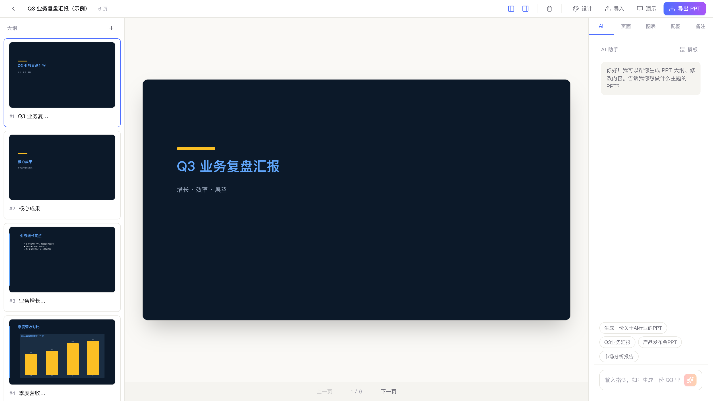
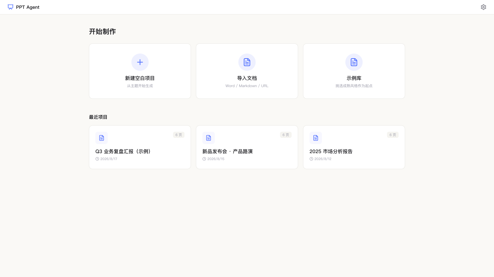

# PPT Agent

[English](README.md) | [简体中文](README.zh-CN.md)

A lightweight AI PPT workstation — runs locally and generates editable `.pptx` files in one click.

## Features

- 🤖 **AI generation**: enter a topic and generate a complete PPT outline.
- 🎛️ **Generation controls**: scenario / tone / information density / target audience / chart preference / page count, constraining the AI before generation.
- 📝 **Outline editor**: drag to reorder, nested bullets, live preview.
- 🎨 **Design system**: 12 built-in palettes × 12 visual styles, plus custom palettes.
- 📊 **Native charts**: bar / line / pie charts that remain editable in PowerPoint.
- 🖼️ **Images** (optional): openly licensed image search via Openverse, applied to a slide from the inspector with one click.
- 📄 **Document import**: Word / Markdown / PDF / URL → PPT.
- 💾 **Local storage**: project data is stored locally for privacy.
- 🔌 **Multi-model support**: OpenAI / Claude / Qwen / Zhipu GLM.
- 🌐 **Multilingual**: switch between Chinese and English instantly; the preference is persisted.
- 🌙 **Dark mode**: light / dark / follow system.

## Screenshots

| Editor: outline + live preview + AI panel | Home: new project / import / examples |
| --- | --- |
|  |  |

## Quick start

```bash
# install dependencies
pnpm install

# development
pnpm tauri:dev

# build
pnpm tauri:build
```

## Auto-update and releases

The app integrates the Tauri updater (Settings → General → About & Updates; check for and install updates there). Releases are tag-driven:

1. **Sync versions**: keep `package.json`, `src-tauri/tauri.conf.json`, and `src-tauri/Cargo.toml` in sync.
2. **Configure repository secrets** (Settings → Secrets and variables → Actions):
   - `TAURI_SIGNING_PRIVATE_KEY`: the full contents of the signing private key file (`src-tauri/updater.key`, gitignored)
   - `TAURI_SIGNING_PRIVATE_KEY_PASSWORD`: the private key password
3. **Push a tag**: `git tag v0.1.0 && git push origin v0.1.0`.
4. **Review the draft release**: `.github/workflows/release.yml` builds macOS (arm64 / x86_64), Linux, and Windows artifacts, signs the updater bundles, uploads `.sig` files and `latest.json`, and creates a draft release. Publish it manually after verifying the artifacts.

> **Where the signing key comes from**: the full contents of `src-tauri/updater.key` are `TAURI_SIGNING_PRIVATE_KEY`. Prefer `gh secret set TAURI_SIGNING_PRIVATE_KEY < src-tauri/updater.key` to avoid exposing the key in the terminal; you can also `pbcopy < src-tauri/updater.key` and paste it into GitHub Secrets. The password is set when you run `pnpm tauri signer generate`; it is not stored in the key file, so retrieve it from your password vault. Use `gh secret set TAURI_SIGNING_PRIVATE_KEY_PASSWORD` to enter it interactively. If the password is lost, rotate the keypair before the first official release: back up the old files, run `pnpm tauri signer generate -w src-tauri/updater.key -f`, write the new public key into `plugins.updater.pubkey` in `src-tauri/tauri.conf.json`, and update both secrets. Rotating the key after a release prevents older versions from verifying new updates.

After publishing, the update endpoint is `https://github.com/logic-cn/ppt-agent/releases/latest/download/latest.json`; when its `version` is higher than the installed version, clients detect an update.

Local signed build:

```bash
export TAURI_SIGNING_PRIVATE_KEY_PATH=src-tauri/updater.key
export TAURI_SIGNING_PRIVATE_KEY_PASSWORD='<key password>'
pnpm tauri:build
```

> For distribution in mainland China, add a `latest.json` URL pointing to your own CDN/OSS under `plugins.updater.endpoints` in `src-tauri/tauri.conf.json`; the public key (`pubkey`) stays the same.

## Usage

1. Open the app and click "New Blank Project".
2. Enter a PPT topic in the AI panel on the right (e.g., "Q3 business review").
3. For finer control, open the "Options" panel above the input, set the scenario (business review / fundraising pitch / training, etc.), tone (formal / consulting, etc.), information density, target audience, chart preference, and page count, then send the topic.
4. The AI generates an outline; drag to reorder slides and adjust each slide's layout on the left.
5. When the preview looks good, click "Export PPT" to download the `.pptx` file.

## Configuration

**No configuration is required by default**: the app includes an on-device small model (see "Built-in on-device model" below); it downloads the model automatically on first generation and works offline. To use a stronger cloud model, enter an LLM API key in Settings:

| Provider | Base URL | Model |
| --- | --- | --- |
| OpenAI | `https://api.openai.com/v1` | `gpt-4o` |
| Anthropic | `https://api.anthropic.com/v1` | `claude-sonnet-4-20250514` |
| Qwen | `https://dashscope.aliyuncs.com/compatible-mode/v1` | `qwen-max` |
| Zhipu GLM | `https://open.bigmodel.cn/api/paas/v4` | `glm-4-plus` |

## Built-in on-device model

Without any API key, the app uses the embedded llama.cpp (CPU inference) to drive the **MiniCPM5** on-device model end-to-end; switch to an external model at any time if the results are not good enough.

- **Tiers**:

  | Tier | Model | Quantization | Size | Suggested RAM | Context |
  | --- | --- | --- | --- | --- | --- |
  | Standard (recommended) | MiniCPM5-2B | Q4_K_M | ~1.45 GB | ≥ 8 GB | 16K |
  | Fast (low-spec) | MiniCPM5-1B | Q4_K_M | ~0.64 GB | ≥ 4 GB | 8K |

- **Distribution**: models are downloaded on demand on first use (ModelScope as the primary source and hf-mirror as the fallback, with automatic failover), support resumable downloads and sha256 integrity verification, and are stored in the app data directory `models/`. Settings → Local model lets you download, delete, and switch tiers. The installer does not bundle model weights.
- **Pipeline**: the local model uses exactly the same generation pipeline as the cloud (pagePlan → per-page SVG → native PPTX translation). The structured step (page planning) uses llama.cpp **grammar-constrained decoding** to guarantee 100% valid JSON. The local tier automatically uses compact prompts (a single few-shot example, a truncated shape/icon vocabulary) to reduce prefill overhead, and the per-page soft timeout is relaxed to 5 minutes.
- **Performance**: on Apple Silicon, MiniCPM5-2B runs at about 40–45 tok/s (limiting to 2 threads makes almost no difference; small models are memory-bandwidth bound). One SVG page (~2–3K tokens) takes about 1 minute; a 10-page deck takes about 10–15 minutes. On low-end x86 laptops, expect 1.5–5 minutes per page; use the Fast tier.
- **License and attribution**: MiniCPM5 is Apache-2.0 (© OpenBMB); the inference engine llama.cpp / ggml is MIT. After the model is downloaded, the full license text is written to `<model>.LICENSE.txt` in the model directory. The About section in Settings lists third-party components.
- **Debug knob**: the `PPT_LOCAL_THREADS` environment variable limits the number of inference threads (used to simulate low-end machines in benchmarks).
- **Limitations**: the local tier is a non-multimodal model, so visual self-checks are skipped. Network-dependent features such as image search and web research are unaffected but optional.
- **Headless E2E**: `scripts/local-e2e/` provides a GUI-less end-to-end run (load the real model → generate a real multi-page deck → export PPTX → produce an acceptance report) to validate quality with the on-device model (layout rotation / speaker notes / export lock). The model must be downloaded first; see the README in that directory. This is a minutes-long manual tool and is not part of CI.

## Language and theme

- **Language**: choose Chinese / English under Settings → General. Changes take effect immediately and are persisted to `settings.json`. AI-generated content also follows the UI language (the Chinese UI generates Chinese PPTs).
- **Theme**: light / dark / follow system. Dark and Follow system add `.dark` to the root element, and all semantic color tokens (background / border / text / accent) switch accordingly.

## Tech stack

- **Desktop framework**: Tauri 2 + Rust
- **Frontend**: React 18 + TypeScript + Tailwind CSS + Vite
- **State management**: Zustand
- **PPT generation**: PptxGenJS
- **LLM integration**: OpenAI SDK (compatible with multiple providers)
- **Charts**: PptxGenJS native charts
- (Recent improvements: svgStale sync, chart quality gate, single-slide redraw toast)

## Project structure

```text
src/
├── types/          # core data models
├── store/          # Zustand stores
├── services/       # LLM adapters, outline generation, document import
├── engine/         # preview renderer, PPTX export engine
├── components/     # outline editor, AI chat panel
├── themes/         # built-in themes (JSON)
└── pages/          # Home, Editor, Settings
```

## Development

```bash
pnpm dev              # frontend only
pnpm tauri:dev        # Tauri app
pnpm test             # full test suite + coverage thresholds
pnpm typecheck        # type check
pnpm format:check     # format check
pnpm build            # frontend build
```

## Continuous integration

`.github/workflows/ci.yml` runs `format:check`, `typecheck`, `test` (with coverage thresholds), and the frontend build on pushes to `main` and on pull requests. See "Auto-update and releases" above for the release flow.

## X1 architecture: SVG design-truth pipeline

X1 refactors rendering from programmatic geometry drawing to "SVG as the page design truth + native PPTX translation", making generated decks attractive, keeping preview and export consistent, and making exports fully editable.

### Pipeline

1. **Design lock (specLock)**: derives a design contract for the canvas (1280×720 px viewBox), colors, and fonts from `visualStyles` / `palettes`.
2. **Page plan (pagePlan)**: `generatePagePlan` calls the LLM to produce each page's semantic role (cover / content / metrics / …) and content plan, without pixel coordinates.
3. **Serial per-page SVG generation (executor)**: the orchestration entry point `buildDeckSvgs` (pipeline.ts) first produces the pagePlan; its internal `generateDeckSvgs` then calls `generateSlideSvg` in page order (no parallelism), injecting specLock + pagePlan to produce a single-page `<svg viewBox="0 0 1280 720">` design truth.
4. **Quality gate (checkSvg + redraw)**: `generateSlideSvg` integrates `checkSvg` bounds/overflow checks. If the first round reports errors, the issues are fed back for a redraw, up to 2 rounds. The final `validateSvgContract` contract guard throws on invalid output.
5. **SvgViewer preview**: the preview renders `slide.svg` inline natively; the preview is the export result.
6. **SVG → native PPTX translation (svgToPptx)**: `translateSvgToSlide` translates each element into pptxgenjs native `addText` / `addShape` / `addChart`; exports are editable objects, not images.
7. **Single-page redraw**: the "Redraw this page" button at the bottom of the preview calls `regenerateSlide` to regenerate that page's SVG as a stability fallback.

### Technical boundaries

- **Gradient approximation**: `linearGradient` / `radialGradient` are limited by pptxgenjs; they are translated into segmented color blocks or average-color approximations (see `resolveFill` in `gradient.ts`).
- **Paths prefer native shapes**: recognized circle / ellipse / rounded rectangle / line elements are mapped to native PPTX shapes; unrecognized closed `<path>` elements fall back to a bounding-box rectangle so their footprint is preserved.
- **Chart convention**: charts inside SVG use `<g data-chart-type="bar|pie|line" data-chart-data='[...]'>`; the translator reads `data-chart-data` to create native, editable pptxgenjs charts.
- **Fixed-pixel viewBox**: every SVG is forced to `viewBox="0 0 1280 720"`; coordinates are mapped to a 13.333×7.5 inch slide via `/1280*13.333` and `/720*7.5`.

## License

MIT
